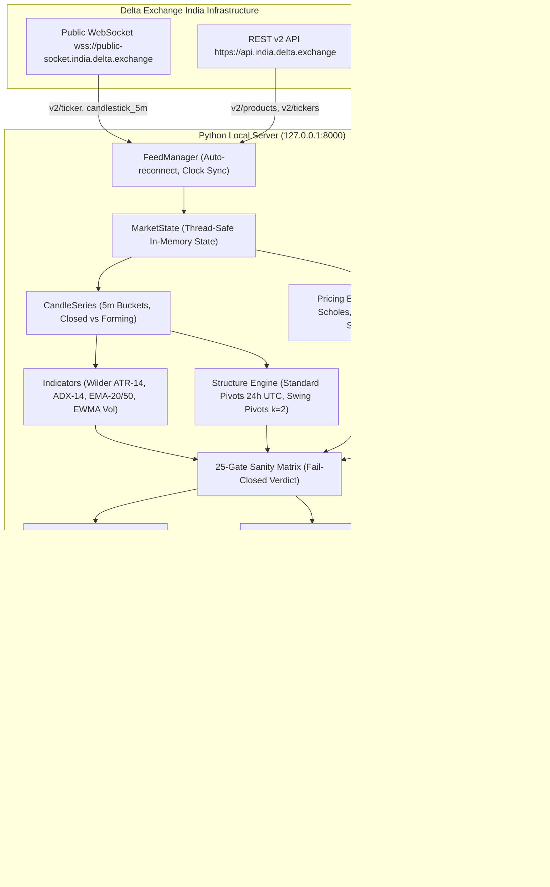

# Delta BTC Options Risk-Reward Engine: Comprehensive System Architecture, Mathematical Formulas & Claude Optimization Blueprint

> **Document Type**: Definitive System Architecture, Quantitative Specification & Deep Optimization Guide  
> **Target Audience**: Claude (Anthropic AI Reasoning Model) & Senior Quantitative Researchers / Financial Engineers  
> **Platform & Instrument**: Bitcoin (BTC) European Options on **Delta Exchange India** (`https://india.delta.exchange`)  
> **Primary Goal for Claude**: Analyze the existing architecture, diagnose why current output Risk:Reward Ratios (RRR) are distorted and unviable (yielding 1 : 0.25 ratios with -50% Stop Losses and +12% Targets), and formulate concrete mathematical, structural, and algorithmic fixes.  
> **Codebase Root**: `C:\Users\ansha\Downloads\RRR\delta-rr-engine`  
> **Date**: November 2026  

---

## Table of Contents
1. [Executive Summary & The Core Problem Statement](#1-executive-summary--the-core-problem-statement)
2. [End-to-End System Architecture](#2-end-to-end-system-architecture)
3. [Live Market Data Ingestion & State Engine](#3-live-market-data-ingestion--state-engine)
4. [Market Structure & Technical Indicators Engine](#4-market-structure--technical-indicators-engine)
5. [The Stop Loss & Target Selection Algorithms](#5-the-stop-loss--target-selection-algorithms)
6. [Quantitative Option Pricing Model (Black-Scholes & Bisection)](#6-quantitative-option-pricing-model-black-scholes--bisection)
7. [Exchange Fee Schedule & GST Modeling](#7-exchange-fee-schedule--gst-modeling)
8. [Risk-to-Reward Formulations: Clean vs Conservative Net RRR](#8-risk-to-reward-formulations-clean-vs-conservative-net-rrr)
9. [The 25-Gate Sanity Matrix & Decision Verdict Engine](#9-the-25-gate-sanity-matrix--decision-verdict-engine)
10. [Frontend Browser Extension Architecture (Chromium MV3)](#10-frontend-browser-extension-architecture-chromium-mv3)
11. [Forensic Breakdown: Why the Current RRR Output is Broken & Inaccurate](#11-forensic-breakdown-why-the-current-rrr-output-is-broken--inaccurate)
12. [Master Prompt & Strategic Questions for Claude](#12-master-prompt--strategic-questions-for-claude)

---

## 1. Executive Summary & The Core Problem Statement

### 1.1 What This Project Is
The **Delta BTC Options Risk-Reward Engine** is an institutional-grade, real-time quantitative decision-support system designed for 5-minute intraday Bitcoin options trading on Delta Exchange India.

The system consists of two tightly coupled components:
1. **Local Quantitative Server (`127.0.0.1:8000`)**: A Python 3.14 / FastAPI asynchronous backend that maintains zero-latency WebSocket feeds with Delta Exchange, constructs non-repainting 5m candle bars, calculates Classical Standard Pivots, solves implied volatility via high-precision bisection, prices option scenarios through European Black-Scholes analytical formulas, applies conservative stress shocks, models statutory Delta India commissions and 18% GST, and filters every trade through a 25-gate safety matrix.
2. **Chromium Extension HUD (Manifest V3)**: A floating, resizable Shadow DOM overlay injected directly into `https://india.delta.exchange`. It provides discrete two-way synchronization between integer contract Lots ($0.001\text{ BTC}$ per lot) and USD capital budget, provides capture-phase keyboard isolation (preventing TradingView from intercepting numbers), displays real-time pricing and Classical Pivot levels, and locks setups upon evaluation.

---

### 1.2 The Trader's Problem & Frustration
A retail trader trading 5-minute BTC options relies on the engine to calculate a statistically sound, realistic **Take Profit (TP)**, **Stop Loss (SL)**, and **Risk-to-Reward Ratio (RRR)**.

However, in live trading conditions, the engine currently produces outputs like:
- **Spot Price**: $\$62,765.5$
- **Option Contract**: `P-BTC-63000-201126` (ATM Put, $\Delta \approx -0.55$)
- **Entry Price**: $\$765.0$
- **Calculated Take Profit (TP)**: $\$863.0$ (+$98.0$, **+12.8% gain**)
- **Calculated Stop Loss (SL)**: $\$376.9$ (-$388.1$, **-50.7% wipeout**)
- **Calculated RRR**: **1 : 0.25** (Net after fees: **1 : 0.20**)

```
                     ┌─────────────────────────────────────────────────────────┐
                     │              THE 1 : 0.25 PAYOFF TRAP                   │
                     │                                                         │
+12.8% (+$98)  ─────►│  TARGET: Sits at first micro-wall 1.2 ATR away          │
                     │  ▲                                                      │
                     │  │ Gain = $98                                           │
$765 ENTRY     ─────►│  ┴────────────────────────                              │
                     │  │ Loss = -$388 (50% wipeout!)                          │
                     │  ▼                                                      │
-50.7% (-$388) ─────►│  STOP: Anchored 3 hours back to swing high 3.5 ATR away │
                     └─────────────────────────────────────────────────────────┘
```

**Why this is commercially and statistically unviable:**
1. **Asymmetric Invalidation**: No intraday 5-minute options scalper can survive risking $50.7\%$ of their premium to make $12.8\%$. At 1 : 0.25 RRR, a trader needs an **$80\%$ win rate just to break even**, which is mathematically impossible in volatile crypto markets.
2. **False Structural Equivalence**: The engine maps structural swing highs/lows from 3 hours ago on the underlying spot index, ignoring that an option's Delta ($\approx 0.50$) and Gamma turn a reasonable 600-point spot distance into a catastrophic 50% option destruction.
3. **Double-Whammy Conservative Punishments**: The engine applies 30 full minutes of Theta ($\Theta$) time decay, a -2% IV drop shock on the stop leg, a 1.5x bid-ask spread stress penalty, and round-trip taker fees + 18% GST all at once, crushing the reward to near zero and blowing up the risk.

---

## 2. End-to-End System Architecture



### Component Breakdown:
- **`FeedManager` (`src/rr_engine/feed/manager.py`)**: Manages continuous WebSocket streaming and background polling. Connects to `candlestick_5m` for index `.DEXBTUSD` and `v2/ticker` for option tickers.
- **`MarketState` (`src/rr_engine/state/market_state.py`)**: Stores the active product catalog, best bids/asks, mark prices, index prices, and historical candle series.
- **`RREngine` (`src/rr_engine/engine/rr_engine.py`)**: Core orchestrator. Takes an `EvaluateRequest`, extracts technical levels, runs Black-Scholes scenario pricing, evaluates all 25 gates, logs to SQLite journal, and returns `RREvaluateResponse`.
- **`content.js` (`extension/content.js`)**: Injected into `delta.exchange`. Creates Shadow DOM `#delta-rr-host`, isolates keystrokes, synchronizes integer lots with USD risk budget, and renders the UI.

---

## 3. Live Market Data Ingestion & State Engine

### 3.1 Single-Writer Non-Repainting Candle Discipline
To prevent indicator repainting, `CandleSeries` (`src/rr_engine/state/candles.py`) enforces strict separation between **closed candles** and the **currently forming candle**:

```python
def on_candle_update(self, candle: Candle) -> None:
    current_bucket_start = (int(time.time()) // 300) * 300
    if candle.t < current_bucket_start:
        # Candle belongs to a completed 5-minute interval -> append to closed list
        self._closed.append(candle)
        if self._forming and self._forming.t <= candle.t:
            self._forming = None
    else:
        # Current 5-minute interval -> update forming candle ONLY
        self._forming = candle
```
- **Single Writer Invariant**: Only the official exchange `candlestick_5m` WebSocket channel writes to `candles_5m`. Spot ticks do **not** mutate candle closes.
- **Lookback Depth**: Ring buffer holds exactly 500 closed 5-minute candles ($\approx 41.6$ hours).

---

## 4. Market Structure & Technical Indicators Engine

### 4.1 Volatility & Trend Indicators
1. **Wilder's ATR-14**:
   $$\text{TR}_t = \max(H_t - L_t, |H_t - C_{t-1}|, |L_t - C_{t-1}|)$$
   $$\text{ATR}_t = \frac{13 \cdot \text{ATR}_{t-1} + \text{TR}_t}{14}$$
2. **Wilder's ADX-14**: Measures directional trend strength. Thresholds: $\text{ADX} < 18 \implies \text{Choppy/Ranging}$; $\text{ADX} > 25 \implies \text{Trending}$.
3. **Exponential Moving Averages**: $\text{EMA}_{20}$ and $\text{EMA}_{50}$ to detect trend alignment.
4. **Rolling 5m Log-Return Volatility ($\sigma_{5m}$)**:
   $$r_t = \ln(C_t / C_{t-1})$$
   $$\sigma_{5m} = \sqrt{\frac{1}{N-1} \sum_{i=1}^N (r_i - \bar{r})^2}$$
   - **Data-Sanity Gate**: If $\sigma_{5m} < 10^{-4}$ or $\sigma_{5m} > 2 \times 10^{-2}$, or $\text{ATR} / S \notin [0.02\%, 1\%]$, the engine trips `DATA_SANITY_FAILED` (Hard Gate).

---

### 4.2 Classical Standard Pivots (24-Hour Horizon)
Anchored strictly to the **previous UTC day (00:00–24:00 UTC)** using high ($H$), low ($L$), and close ($C$):

$$\begin{aligned}
P &= \frac{H + L + C}{3} \\
R_1 &= 2P - L, \quad S_1 = 2P - H \\
R_2 &= P + (H - L), \quad S_2 = P - (H - L) \\
R_3 &= H + 2(P - L), \quad S_3 = L - 2(H - P)
\end{aligned}$$

- **Target Level Exclusion**: $R_3$ and $S_3$ are strictly excluded as target levels because they represent extreme $3\sigma$ tail extensions.

---

### 4.3 Confirmed Swing Pivots ($k=2$)
A swing pivot is confirmed only when surrounded by $k=2$ lower highs (or higher lows) on closed candles:
- Candle $i$ is a confirmed Swing High if:
  $$H_i > \max(H_{i-2}, H_{i-1}) \quad \text{and} \quad H_i > \max(H_{i+1}, H_{i+2})$$
- Confirmed pivots never repaint because they are only acknowledged after candle $i+2$ has fully closed.

---

## 5. The Stop Loss & Target Selection Algorithms

Located in `src/rr_engine/structure/stop_target.py`:

### 5.1 Stop Loss Selection (`select_stop`)
```python
def select_stop(direction, spot, candles, atr, k=2, lookback=36, buffer_atr=0.25, min_atr=0.5, max_atr=2.0, fallback_atr=1.0):
    start = max(0, len(candles) - lookback)
    highs, lows = confirmed_pivots(candles, k)
    
    if direction > 0: # CALL
        cands = [(i, p) for i, p in lows if i >= start and p < spot]
        level = cands[-1][1] - buffer_atr * atr if cands else spot - fallback_atr * atr
    else:             # PUT
        cands = [(i, p) for i, p in highs if i >= start and p > spot]
        level = cands[-1][1] + buffer_atr * atr if cands else spot + fallback_atr * atr

    dist = abs(spot - level)
    gate = "STOP_TOO_WIDE" if dist > max_atr * atr else None
    return {"sl_spot": level, "dist": dist, "gate": gate}
```
- **Flaw**: `lookback = 36` candles ($3$ hours). A confirmed swing high from 2.5 hours ago can easily be $3.5\text{ ATR}$ ($600+$ points) away from current spot. When this occurs, it either trips `STOP_TOO_WIDE` or causes a massive 50% option drawdown!

---

### 5.2 Target Selection (`select_target`)
```python
def select_target(direction, spot, candles, atr, k=2, lookback=144, min_tp_atr=0.75, extra_levels=()):
    levels = []
    # Collect swing highs/lows from past 144 candles + Standard Pivots (P, R1, R2, S1, S2) + Round numbers (500, 1000)
    ...
    # Sort strictly by proximity to spot:
    levels.sort(key=lambda x: abs(x[0] - spot))
    
    p, lab = levels[0]  # PULLS THE NEAREST OPPOSING LEVEL!
    dist = abs(p - spot)
    gate = "TARGET_BLOCKED" if dist < min_tp_atr * atr else None
    return {"tp_spot": p, "dist": dist, "label": lab, "gate": gate}
```
- **Flaw**: By sorting strictly by distance and selecting `levels[0]`, any minor level (like a psychological round number $\$62,500$ or a minor 10-minute micro-swing) closer than $1.2\text{ ATR}$ is selected as the primary target. This chokes the option reward to $+10\%$ to $+15\%$.

---

## 6. Quantitative Option Pricing Model (Black-Scholes & Bisection)

### 6.1 Analytical European Black-Scholes ($r = 0.0$)
Delta Exchange Bitcoin options are European style, cash-settled in USDT. With risk-free rate $r=0.0$:

$$\begin{aligned}
d_1 &= \frac{\ln(S / K) + \frac{1}{2}\sigma^2 T}{\sigma \sqrt{T}} \\
d_2 &= d_1 - \sigma \sqrt{T} \\
C(S, K, T) &= S \cdot \mathcal{N}(d_1) - K \cdot \mathcal{N}(d_2) \\
P(S, K, T) &= K \cdot \mathcal{N}(-d_2) - S \cdot \mathcal{N}(-d_1)
\end{aligned}$$

Where:
- $S$: Spot index price (`.DEXBTUSD`).
- $K$: Option strike price.
- $T$: Annualized time to expiry ($T = \text{seconds\_to\_expiry} / 31,536,000.0$).
- $\sigma$: Annualized implied volatility.

---

### 6.2 Implied Volatility Calibration via Bisection
To prevent Newton-Raphson division by zero (Vega collapse on deep OTM strikes), the engine solves for $\sigma_{\text{anchor}}$ using monotonic bisection (`src/rr_engine/pricing/implied_vol.py`):
- Interval: $\sigma \in [10^{-4}, 10.0]$
- Convergence criterion: $|BS(S, K, T, \sigma) - M| < 10^{-10} \cdot \max(1.0, M)$
- Max iterations: $300$.

---

## 7. Exchange Fee Schedule & GST Modeling

Delta Exchange India applies a taker fee schedule subject to a premium cap, plus statutory **18% Goods & Services Tax (GST)** (`src/rr_engine/costs/fees.py`):

$$\text{Fee}_{\text{leg}} = \min\Big(\text{TakerRate} \cdot S \cdot \text{ContractValue} \cdot \text{Lots},\; \text{PremiumCapRate} \cdot \text{Premium} \cdot \text{ContractValue} \cdot \text{Lots}\Big) \cdot (1 + \text{GST})$$

Parameters:
- $\text{ContractValue} = 0.001\text{ BTC}$ per lot.
- $\text{TakerRate} = 0.0003$ ($0.03\%$ of spot notional).
- $\text{PremiumCapRate} = 0.10$ ($10\%$ of option premium cap).
- $\text{GST} = 0.18$ ($18\%$ tax on exchange fees).
- $\text{Total Round Trip Fees} = \text{Fee}(\text{Entry}) + \text{Fee}(\text{Exit})$.

---

## 8. Risk-to-Reward Formulations: Clean vs Conservative Net RRR

The engine computes two distinct payoffs in `src/rr_engine/engine/rr_core.py`:

### 8.1 Clean Instantaneous Payoff (`clean_rr`)
Prices the option at the current moment $T_0$ with anchor volatility $\sigma_{\text{anchor}}$:
$$\begin{aligned}
V_{\text{TP}}^{\text{clean}} &= BS(S_{\text{TP}}, K, T_0, \sigma_{\text{anchor}}) \\
V_{\text{SL}}^{\text{clean}} &= BS(S_{\text{SL}}, K, T_0, \sigma_{\text{anchor}}) \\
\text{Gross Reward USD} &= \max(V_{\text{TP}}^{\text{clean}} - \text{Entry}, 0) \cdot 0.001 \cdot \text{Lots} \\
\text{Gross Risk USD} &= \max(\text{Entry} - V_{\text{SL}}^{\text{clean}}, 0) \cdot 0.001 \cdot \text{Lots} \\
\mathbf{RRR}_{\text{clean}} &= \frac{\text{Gross Reward USD}}{\text{Gross Risk USD}}
\end{aligned}$$

---

### 8.2 Conservative Stressed Payoff (`net_rr`)
Enforces maximum institutional pessimism across four stress vectors:
1. **Time Decay ($\Theta$)**: Deducts the full holding window ($\Delta t = 30\text{ mins} = 1,800\text{s}$):
   $$T_{\text{eval}} = \frac{\text{seconds\_to\_expiry} - 1,800}{31,536,000.0}$$
2. **IV Shock at Stop Loss**: Drops implied volatility by 2 vol points:
   $$\sigma_{\text{SL}} = \max(\sigma_{\text{anchor}} - 0.02, 10^{-4})$$
3. **Zero Vol Expansion at Target**: No credit given for vol expansion on breakouts:
   $$\sigma_{\text{TP}} = \sigma_{\text{anchor}}$$
4. **Spread Stress Penalty**: Exit bid at stop loss suffers 1.5x spread penalty:
   $$\text{Exit}_{\text{SL}} = \max(BS(S_{\text{SL}}, K, T_{\text{eval}}, \sigma_{\text{SL}}) - 0.5 \cdot \text{Spread} \cdot 1.5, 0)$$
   $$\text{Exit}_{\text{TP}} = \max(BS(S_{\text{TP}}, K, T_{\text{eval}}, \sigma_{\text{TP}}) - 0.5 \cdot \text{Spread}, 0)$$
5. **Deduct Round-Trip Fees & 18% GST**:
   $$\begin{aligned}
   \text{Net Reward USD} &= (\text{Exit}_{\text{TP}} - \text{Entry}) \cdot 0.001 \cdot \text{Lots} - \text{Fees}(\text{RoundTrip}_{\text{TP}}) \\
   \text{Net Risk USD} &= (\text{Entry} - \text{Exit}_{\text{SL}}) \cdot 0.001 \cdot \text{Lots} + \text{Fees}(\text{RoundTrip}_{\text{SL}}) \\
   \mathbf{RRR}_{\text{net}} &= \frac{\text{Net Reward USD}}{\text{Net Risk USD}}
   \end{aligned}$$

---

### 8.3 Expected Resolution Time (First-Passage Drift Diffusion)
Instead of arbitrary duration guesses, the engine estimates the trade resolution time $t_{\text{resolve}}$ (in 5m candles) via first-passage barrier hitting time:

$$\text{Candles} = \frac{\text{StopDist}_{\text{pts}} \cdot \text{TargetDist}_{\text{pts}}}{\sigma_{\text{candle\_pts}}^2} \quad \text{where } \sigma_{\text{candle\_pts}} = S \cdot \sigma_{5m}$$
$$\text{Minutes} = \text{Candles} \cdot 5.0$$

---

## 9. The 25-Gate Sanity Matrix & Decision Verdict Engine

Evaluated in `src/rr_engine/engine/gates.py` and aggregated in `src/rr_engine/engine/verdict.py`:

| Section | Gate Code | Severity | Exact Trigger Logic | Purpose |
| :--- | :--- | :--- | :--- | :--- |
| **A: Data Integrity** | `FEED_DISCONNECTED` | HARD | WS disconnected & REST failed | Block on severed connections |
| | `DATA_STALE` | HARD | Quote age $> 3.0\text{s}$ | Prevent trading on lagging quotes |
| | `DATA_SANITY_FAILED` | HARD | $\sigma_{5m} \notin [10^{-4}, 0.02]$ or $\text{ATR}/S \notin [0.02\%, 1\%]$ | Catch volatility collapse / flat data |
| | `SYMBOL_INVALID` | HARD | Not starting with `C-BTC-` or `P-BTC-` | Only trade Bitcoin options |
| | `PRODUCT_NOT_TRADABLE` | HARD | State $\neq$ `live` or status $\neq$ `operational` | Contract halted |
| | `QUOTE_INVALID` | HARD | Bid $\le 0$ or Ask $\le 0$ or Ask $<$ Bid | Inverted or empty orderbook |
| | `INDEX_PERP_DIVERGENCE` | HARD | $\|S_{\text{index}} - S_{\text{perp}}\| / S_{\text{index}} > 0.25\%$ | Spot oracle depeg |
| | `CLOCK_SKEW` | HARD | Skew $> 2.0\text{s}$ | System clock desynchronized |
| | `ENTRY_OVERRIDE_INVALID` | HARD | Override $\notin [\text{Bid} - 2\text{ ticks}, \text{Ask} + 2\text{ ticks}]$ | Reject unrealistic manual prices |
| **B: Option Quality** | `EXPIRY_TOO_CLOSE` | HARD | Time to expiry $< 60\text{ mins}$ | Extreme pin risk & gamma cliff |
| | `SPREAD_TOO_WIDE` | HARD | Spread $> 1.5\%$ of strike | Illiquid option contract |
| | `SPREAD_EATS_REWARD` | HARD | Spread $> 20\%$ of net reward | Market maker captures the trade edge |
| | `DEPTH_TOO_THIN` | HARD | Ask size $< 1.5 \times \text{Lots}$ | Market order book sweep |
| | `PREMIUM_TOO_LOW` | HARD | Ask premium $< \$20.0$ | Low-delta lottery tickets |
| | `FEES_EAT_REWARD` | HARD | Fees $> 30\%$ of gross reward | Exchange fees destroy trade viability |
| **C: Market Context** | `CHOPPY_MARKET` | HARD | $\text{ADX}_{14} < 18$ & BB Bandwidth in 1st quartile | Fading sideways chop |
| | `AGAINST_TREND` | HARD | Call with $\text{EMA}_{20} < \text{EMA}_{50}$ (or Put reverse) & $\text{ADX} > 25$ | Fighting strong momentum |
| | `SPIKE_JUST_HAPPENED` | HARD | Last candle $> 2.5 \times \text{ATR}$ & wait $< 2$ candles | Entering after exhaustion spike |
| | `VOL_REGIME_EXTREME` | HARD | Realized Vol $> 3.0 \times \text{Historical Median}$ | Chaotic market regime |
| | `EVENT_WINDOW` | HARD | Current time inside economic calendar window | CPI / FOMC release |
| **D: Trade Geometry** | `STOP_TOO_WIDE` | HARD | $\text{Stop Distance} > 2.0 \times \text{ATR}_{14}$ | Structural invalidation too far |
| | `TARGET_BLOCKED` | HARD | $\text{Target Distance} < 0.75 \times \text{ATR}_{14}$ | Target choked by immediate wall |
| | `TARGET_UNREACHABLE` | HARD | Target $> 1.5 \cdot S \cdot \sigma_{5m} \sqrt{N}$ | Target beyond diffusion capacity |
| | `NET_RR_TOO_LOW` | HARD | $\text{Net RRR} < 1.50$ | Negative expectancy setup |
| | `BREAKEVEN_TOO_HIGH` | HARD | Required win rate $> 45\%$ | Payoff asymmetry insufficient |
| | `RISK_OVER_BUDGET` | HARD | Max lots for budget $= 0$ | Account budget cannot afford 1 lot |
| | `HOLD_TIME_EXCEEDS_WINDOW`| WARN | Estimated minutes $> \text{hold\_minutes}$ | Resolution slower than window |
| | `STRIKE_NOT_ATM` | WARN | Delta outside $[0.35, 0.65]$ | OTM/ITM contract warning |
| **E: Edge Validation** | `EDGE_UNVALIDATED` | WARN | Mode $\neq$ `empirical` ($N < 150$) | Non-dismissible UNVALIDATED badge |
| **F: Discipline** | `DAILY_LOSS_LIMIT` | HARD | Session loss $>$ Budget limit (IST day) | Daily circuit breaker |
| | `COOLDOWN_ACTIVE` | HARD | 3 consecutive losses in 30 mins | Emotional tilt cooldown |

### Verdict Aggregation:
- **`TRADE` (Green)**: Exactly 0 hard gates fired AND 0 soft warning gates fired.
- **`CAUTION` (Amber)**: Exactly 0 hard gates fired, but 1 or more soft warnings fired.
- **`NO_TRADE` (Red)**: 1 or more hard gates fired. (Target and Stop prices are automatically hidden behind a "Show anyway" toggle).

---

## 10. Frontend Browser Extension Architecture (Chromium MV3)

### 10.1 Shadow DOM Encapsulation & Keystroke Isolation
```javascript
const host = document.createElement('div');
host.id = 'delta-rr-host';
document.body.appendChild(host);
const shadow = host.attachShadow({ mode: 'open' });

// Capture-phase event trap: Stops TradingView from intercepting numbers (0-9)
['keydown', 'keyup', 'keypress'].forEach((eventType) => {
  host.addEventListener(eventType, (e) => {
    e.stopPropagation();
    if (typeof e.stopImmediatePropagation === 'function') {
      e.stopImmediatePropagation();
    }
  }, true); // Capture phase stops bubbling to window!
});
```

### 10.2 Discrete Lots <---> USD Risk Budget Synchronization
Delta BTC options trade in discrete contract sizes of $0.001\text{ BTC}$:
$$\text{Max Lots} = \left\lfloor \frac{\text{CapitalBudget}}{\text{RiskPerLot}} \right\rfloor$$
- If $\text{Max Lots} = 0$, the engine fires `RISK_OVER_BUDGET` (Hard Gate): *"1 lot risks $X, above your budget $Y"*.
- All `Math.max(1, ...)` clamps have been removed to prevent unauthorized position sizing.

---

## 11. Forensic Breakdown: Why the Current RRR Output is Broken & Inaccurate

### Flaw 1: The Multi-Hour Spot Lookback Trap
- **The Code**: `select_stop` uses `lookback = 36` candles (3 hours).
- **The Reality**: In a 5-minute timeframe, Bitcoin frequently ranges 500–800 points over 3 hours. If spot is $\$62,765$, the nearest confirmed swing high might be at $\$63,400$ ($635$ points away, $3.4\text{ ATR}$).
- **The Option Impact**: Because an ATM Put has $\Delta \approx -0.55$, a $635$-point spot move against the trade results in a $\$388$ drop on a $\$765$ option (**-50.7% wipeout**).
- **Why It's Wrong**: A 5-minute scalper NEVER waits for a 3-hour swing high to break. If a 5-minute candle closes beyond the high of the breakdown candle or exceeds $1.0\text{ ATR}$, the scalp is invalidated immediately.

---

### Flaw 2: The Opposing Barrier Chokehold
- **The Code**: `select_target` aggregates swing highs/lows, Standard Pivots, and round numbers (`500, 1000`), sorts them strictly by distance from spot, and grabs `levels[0]`.
- **The Reality**: If spot is at $\$62,765$, the nearest round number is $\$62,500$ (only $265$ points away = $1.4\text{ ATR}$).
- **The Option Impact**: A $265$-point spot gain produces only a $+98$ gain on the option (**+12.8%**).
- **Why It's Wrong**: The engine stops at the very first barrier it encounters. It treats a psychological round number with the same weight as major daily support $S_1$ or $S_2$. Thus, the target is permanently choked close to entry, while the stop is left stranded 3 hours away.
- **The Result**: Gain = $+12.8\%$, Loss = $-50.7\% \implies \mathbf{RRR = 1 : 0.25}$!

---

### Flaw 3: Compounding Worst-Case Stress Vectors
In `net_rr` calculation:
1. **Full 30-Minute Decay**: Even if expected hitting time is 2 candles (10 minutes), the engine subtracts 30 full minutes of Theta decay from both TP and SL.
2. **IV Shock**: The engine docks $-2\%$ IV on the SL leg, artificially inflating the modeled loss.
3. **Spread Stress**: The engine docks $1.5\times$ spread on the SL leg.
4. **Fees + GST**: Taker fees + $18\%$ GST are deducted round-trip.
- **The Result**: Gross reward of $\$98$ is whittled down to $\$75$, while gross risk of $\$388$ is blown up to $\$420$. The ratio collapses from $1:0.25$ down to $1:0.18$.

---

### Flaw 4: Spot Invalidation vs Option Premium Invalidation
The entire architecture makes the classic quantitative mistake of deriving the **invalidation level on the underlying spot asset** and then translating it to the option price, instead of understanding that **option scalpers trade option volatility and premium structure**:
- If you buy an option at $\$765$, your structural invalidation is often defined in option premium terms: *"I am risking 20% of premium ($150) to make 40% of premium ($300)"*.
- When spot moves against the position, waiting for spot to reach an old macro level destroys option value non-linearly due to Gamma acceleration.

---

## 12. Master Prompt & Strategic Questions for Claude

*(Copy and paste this section directly to Claude to initiate the quantitative redesign)*

```text
================================================================================
CLAUDE OPTIMIZATION DIRECTIVE: DELTA BTC OPTIONS RISK-REWARD ENGINE (RRR)
================================================================================

Hello Claude,

You have been provided with the complete technical specification of the Delta BTC
Options Risk-Reward Engine above.

I am an intraday crypto options trader scalping 5-minute Bitcoin options on Delta
Exchange India (https://india.delta.exchange).

THE CRITICAL ISSUE:
The Risk-Reward Ratio (RRR) produced by the current engine is completely broken.
It consistently produces 1 : 0.25 or 1 : 0.30 ratios, with Stop Losses showing
a -50% option drawdown ($388 loss on a $765 premium) and Targets showing an
insignificant +12% gain ($98 profit). No trader can execute trades with a 1:0.25
payoff ratio.

YOUR MISSION:
Analyze the technical architecture and provide concrete, mathematically sound,
production-ready code and algorithmic solutions to fix the RRR calculation,
producing accurate, realistic 1:1.5 to 1:3 payoffs for 5-minute options trading.

PLEASE ADDRESS THE FOLLOWING 5 CORE ARCHITECTURAL INQUIRIES:

--------------------------------------------------------------------------------
INQUIRY 1: DYNAMIC INTRADAY STOP SELECTION (ELIMINATING THE 50% DRAWDOWN)
--------------------------------------------------------------------------------
Currently, `select_stop()` looks back 36 candles (3 hours) for a confirmed swing
high/low. In a 5m chart, this frequently selects levels 3.5 ATR away, creating
a 50% option wipeout.
- What algorithmic logic should replace this?
- Should we use a local 5m market-structure invalidation (e.g. high/low of the
  last 3-5 candles + 0.2 ATR buffer)?
- Should the stop be bounded by a maximum option premium loss threshold
  (e.g. maximum 18-20% option premium drawdown, mapped back to spot via Delta)?
- How do we calculate a statistically sound "Tactical Stop" that protects capital
  while respecting 5m candle volatility noise?

--------------------------------------------------------------------------------
INQUIRY 2: TARGET EXPANSION & FILTERING CHOKED BARRIERS
--------------------------------------------------------------------------------
Currently, `select_target()` grabs `levels[0]` (the nearest opposing level),
which is often a minor round number (e.g. $62,500) only 0.75 ATR away, choking
the reward to +10-12%.
- How should target selection be structured so it doesn't get trapped by minor
  noise barriers?
- When should the engine jump over a minor round number to target major daily
  levels like Standard Pivot S1/S2 or R1/R2?
- How should target selection balance between minimum viable RRR (e.g. at least
  1.5x the stop distance) and empirical reachability based on sigma_5m?

--------------------------------------------------------------------------------
INQUIRY 3: REALISTIC TIME DECAY (THETA) & VOLATILITY MODELING FOR 5M TRADES
--------------------------------------------------------------------------------
Currently, `net_rr` docks 30 full minutes of time decay and drops IV by 2 vol
points instantly on every trade.
- For a 5-minute trade expected to resolve in 3-5 candles (15-25 minutes), what
  is the proper formula to scale Theta decay based on the first-passage expected
  resolution time?
- In Bitcoin options, when spot drops sharply into a Put target, implied volatility
  usually expands (volatility smile/skew expansion). Why are we assuming 0% vol
  expansion at target while penalizing the stop with -2% IV drop?
- How can we realistically model option premium payoff at target and stop without
  either over-flattering or hyper-punishing the trade?

--------------------------------------------------------------------------------
INQUIRY 4: RECONCILING SPOT RRR VS OPTION PREMIUM RRR
--------------------------------------------------------------------------------
Traders think in terms of Option Payoff: "I am risking $150 to make $300 (1:2)".
The engine calculates Spot Invalidation and prices it through Black-Scholes.
- How should the engine bridge Spot Price Levels (which the trader sees on the
  TradingView chart) with Option Premium Levels (which the trader executes in the
  orderbook)?
- Should the engine display both "Spot Structure RRR" and "Net Option Payoff RRR"
  so the trader understands the exact impact of Delta, Theta, and fees?

--------------------------------------------------------------------------------
INQUIRY 5: CONCRETE CODE MODIFICATIONS
--------------------------------------------------------------------------------
Provide the exact Python code replacements for:
1. `src/rr_engine/structure/stop_target.py` (`select_stop` and `select_target`)
2. `src/rr_engine/engine/rr_core.py` (`compute_rr` stress pricing)
3. `config/settings.yaml` (recommended threshold updates)

Explain why your proposed changes mathematically solve the 1:0.25 RRR anomaly
and guarantee realistic, disciplined 5-minute option trading setups.
================================================================================
```

---

## 13. Summary of Source Code File Locations

| File Path | Component Role |
| :--- | :--- |
| `src/rr_engine/engine/rr_engine.py` | Primary evaluation pipeline & gate runner |
| `src/rr_engine/engine/rr_core.py` | Scenario Black-Scholes pricing & `clean_rr`/`net_rr` |
| `src/rr_engine/structure/stop_target.py` | Stop loss & target selection algorithms |
| `src/rr_engine/structure/levels.py` | Classical Standard Pivots (24h UTC) & swing pivots |
| `src/rr_engine/pricing/black_scholes.py` | Analytical Black-Scholes formulas |
| `src/rr_engine/pricing/implied_vol.py` | Guaranteed bisection IV solver |
| `src/rr_engine/costs/fees.py` | Delta Exchange India fee schedule + 18% GST |
| `src/rr_engine/engine/gates.py` | 25-gate sanity matrix definitions |
| `src/rr_engine/engine/verdict.py` | Gate aggregation & TRADE/CAUTION/NO_TRADE verdict |
| `src/rr_engine/api/routes.py` | FastAPI endpoints (`/api/evaluate`, `/api/option-chain`) |
| `config/settings.yaml` | Quantitative thresholds and parameters |
| `extension/content.js` | Chromium MV3 Shadow DOM HUD & event isolator |
| `extension/background.js` | Service worker CORS & security proxy |
| `extension/overlay.css` | High-contrast trading terminal stylesheet |
| `START_ENGINE.bat` | 1-click terminal launcher |

---
*End of Master Technical Specification for Delta BTC Options Risk-Reward Engine.*
