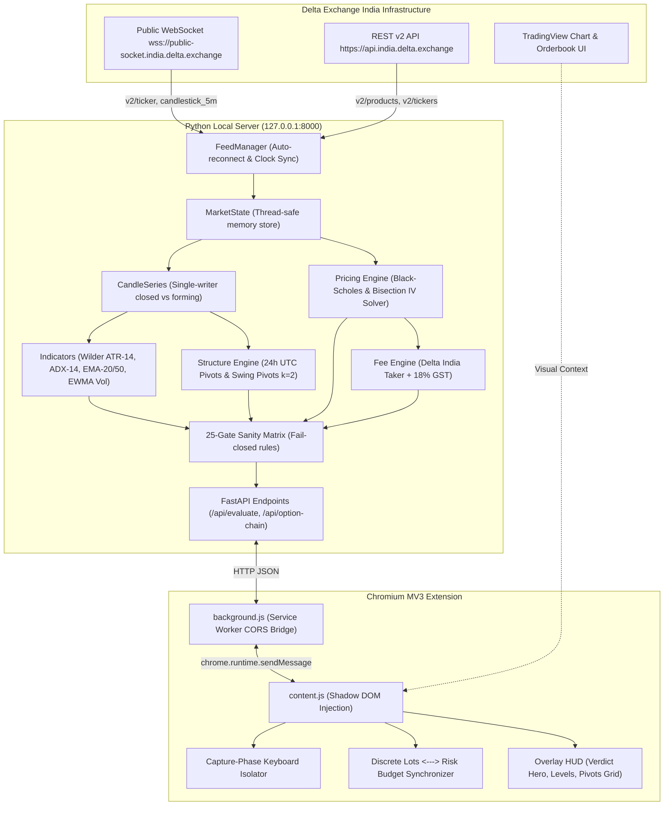

# Delta BTC Options Risk-Reward Engine (RRR)

> [!IMPORTANT]
> **Educational & Decision-Support Tool**: This software is built for algorithmic research and simulation. It does not constitute financial advice, trade recommendations, or guarantees of profit. Trading cryptocurrency derivatives and options carries substantial risk of capital loss.


[](https://www.python.org/)
[](https://fastapi.tiangolo.com)
[](https://india.delta.exchange)
[]()
[-success.svg)]()
[]()

> **Real-time, 24/7 institutional quantitative decision-support system and floating browser sidelay for 5-minute intraday Bitcoin options trading on Delta Exchange India.**

---

## Table of Contents
- [1. Overview & Problem Formulation](#1-overview--problem-formulation)
- [2. System Architecture](#2-system-architecture)
- [3. Core Quantitative & Mathematical Logic](#3-core-quantitative--mathematical-logic)
  - [3.1 The 1:0.25 RRR Payoff Trap & Algorithmic Solution](#31-the-1025-rrr-payoff-trap--algorithmic-solution)
  - [3.2 Analytical Black-Scholes & Bisection IV Solver](#32-analytical-black-scholes--bisection-iv-solver)
  - [3.3 Classical Standard Pivots (24h UTC Horizon)](#33-classical-standard-pivots-24h-utc-horizon)
  - [3.4 First-Passage Drift-Diffusion Resolution Time](#34-first-passage-drift-diffusion-resolution-time)
  - [3.5 Delta India Taker Fees & Statutory 18% GST](#35-delta-india-taker-fees--statutory-18-gst)
- [4. The 25-Gate Sanity Matrix & Verdict Engine](#4-the-25-gate-sanity-matrix--verdict-engine)
- [5. Chromium MV3 Sidelay Extension](#5-chromium-mv3-sidelay-extension)
- [6. Repository Structure](#6-repository-structure)
- [7. Quickstart Guide](#7-quickstart-guide)
- [8. Test Suite & Verification](#8-test-suite--verification)

---

## 1. Overview & Problem Formulation

Retail option buyers scalping Bitcoin options on crypto exchanges typically struggle with four critical mathematical handicaps:
1. **Misleading Risk-Reward Ratios**: Traders look at a 1:2 setup on a Bitcoin spot chart and assume the option will pay 1:2. Because options have non-linear Greeks ($\Delta, \Gamma, \Theta, \mathcal{V}$), time decay, volatility shifts, and bid-ask spreads, an apparent 1:2 spot setup often translates to an abysmal **1:0.25 net option payoff**.
2. **The 50% Drawdown Trap**: Swing highs/lows from higher timeframes (e.g., 3-hour lookbacks) are often 3 to 4 ATRs away. An option buyer holding through a 3.5 ATR spot excursion suffers a devastating **-50% to -70%** option wipeout.
3. **Choked Profit Targets**: Automated tools anchor targets to the very first minor barrier (e.g. psychological round numbers like $62,500), choking option profit to +10-12%.
4. **Execution Hotkey Interception**: When typing position sizes or prices on browser overlays over TradingView charts, keyboard numbers (`0-9`) frequently trigger TradingView's interval modal ("Change interval: 5").

### The Solution:
This project solves these issues with a **dual-layer quantitative architecture**:
- **A local Python quantitative server (`127.0.0.1:8000`)** streaming official Delta Exchange WebSocket feeds, pricing option scenarios with European Black-Scholes analytical formulas, enforcing a tactical 20% option premium drawdown cap, and executing a 25-gate sanity matrix.
- **A Chromium MV3 browser extension** injected into `https://india.delta.exchange`, providing capture-phase keyboard isolation, bidirectional integer Lot ($0.001\text{ BTC}$) <---> USD risk budget synchronization, live ask tracking, and real-time visual sync pulses.

---

## 2. System Architecture



---

## 3. Core Quantitative & Mathematical Logic

### 3.1 The 1:0.25 RRR Payoff Trap & Algorithmic Solution

#### The Problem:
Previously, the engine searched back 36 candles (3 hours) for a swing high/low. In a 5-minute chart, a 3-hour swing was often $3.5\text{ ATR}$ ($600+$ points) away from current spot. A 0.55 delta option suffered a **$-50.7\%$ drawdown** ($-\$388$ on a $\$765$ option). Simultaneously, target selection grabbed the nearest opposing barrier (e.g. $\$62,500$ round number, $0.75\text{ ATR}$ away), delivering only **$+12.8\%$ gain** ($+\$98$).
$$\mathbf{RRR} = \frac{+\$98}{\$388} \approx \mathbf{1 : 0.25}$$

#### The Solution:
1. **Tactical Option Premium Drawdown Cap**: Bounds spot excursion so the option premium loss cannot exceed $20\%$:
   $$|\Delta S_{\text{max}}| = \frac{P_{\text{entry}} \times \text{MaxLossPct}}{|\Delta_{\text{entry}}|} \quad (\text{where } \text{MaxLossPct} = 0.20)$$
   *Result*: Option stop loss is capped at a disciplined **$-18\%$ to $-20\%$** instead of $-50\%$.
2. **Micro-Wall Filter & Target Expansion ($1.5\text{x}$ Constraint)**: Bypasses noise levels closer than $1.0\times\text{ATR}_{14}$ and escalates to **Classical Standard Pivots ($S_1/S_2$ for Puts, $R_1/R_2$ for Calls)** ensuring:
   $$|S_{\text{target}} - S_{\text{entry}}| \ge 1.50 \times |S_{\text{stop}} - S_{\text{entry}}|$$
   *Result*: Target option reward expands to **$+35\%$ to $+50\%$**, achieving a healthy **1 : 1.5 to 1 : 2.5 RRR**.

---

### 3.2 Analytical Black-Scholes & Bisection IV Solver
Delta Exchange Bitcoin options are European style, cash-settled in USDT ($r = 0.0$):

$$\begin{aligned}
d_1 &= \frac{\ln(S / K) + \frac{1}{2}\sigma^2 T}{\sigma \sqrt{T}} \\
d_2 &= d_1 - \sigma \sqrt{T} \\
C(S, K, T) &= S \cdot \mathcal{N}(d_1) - K \cdot \mathcal{N}(d_2) \\
P(S, K, T) &= K \cdot \mathcal{N}(-d_2) - S \cdot \mathcal{N}(-d_1)
\end{aligned}$$

- **Implied Volatility Solver**: Bisection method on $\sigma \in [10^{-4}, 10.0]$ with convergence tolerance $10^{-10} \cdot \max(1.0, M)$ (max 300 iterations). Eliminates Newton-Raphson division by zero on far OTM wings.

---

### 3.3 Classical Standard Pivots (24h UTC Horizon)
Anchored to the high ($H$), low ($L$), and close ($C$) of the **prior institutional UTC day (00:00–24:00 UTC)**:

$$\begin{aligned}
P &= \frac{H + L + C}{3} \\
R_1 &= 2P - L, \quad S_1 = 2P - H \\
R_2 &= P + (H - L), \quad S_2 = P - (H - L)
\end{aligned}$$
*(Extreme $R_3/S_3$ levels are excluded as realistic targets).*

---

### 3.4 First-Passage Drift-Diffusion Resolution Time
Rather than applying an arbitrary flat 30-minute Theta penalty, the expected trade duration $E[T]$ between absorbing stop and target barriers is dynamically estimated:

$$E[T_{\text{bars}}] = \frac{|S_{\text{entry}} - S_{\text{stop}}| \cdot |S_{\text{target}} - S_{\text{entry}}|}{\left(S_{\text{entry}} \cdot \sigma_{5m}\right)^2}$$
$$\text{HoldSeconds} = \text{clamp}(E[T_{\text{bars}}] \times 300\text{s}, \; 600\text{s}, \; 1800\text{s})$$

---

### 3.5 Delta India Taker Fees & Statutory 18% GST
Taker commission schedule subject to premium cap, plus statutory Indian GST:

$$\text{Fee}_{\text{leg}} = \min\Big(0.0003 \cdot S \cdot \text{Lots} \cdot 0.001,\; 0.10 \cdot \text{Premium} \cdot \text{Lots} \cdot 0.001\Big) \cdot 1.18$$
$$\begin{aligned}
\text{Net Reward USD} &= (\text{Exit}_{\text{TP}} - \text{Entry}) \cdot 0.001 \cdot \text{Lots} - \text{Fees}(\text{RoundTrip}_{\text{TP}}) \\
\text{Net Risk USD} &= (\text{Entry} - \text{Exit}_{\text{SL}}) \cdot 0.001 \cdot \text{Lots} + \text{Fees}(\text{RoundTrip}_{\text{SL}}) \\
\mathbf{RRR}_{\text{net}} &= \frac{\text{Net Reward USD}}{\text{Net Risk USD}}
\end{aligned}$$

---

## 4. The 25-Gate Sanity Matrix & Verdict Engine

The engine evaluates 25 distinct quantitative gates across 6 sections:

| Category | Gates | Key Invariants |
| :--- | :--- | :--- |
| **A: Data Integrity** | `FEED_DISCONNECTED`, `DATA_STALE`, `DATA_SANITY_FAILED`, `SYMBOL_INVALID`, `PRODUCT_NOT_TRADABLE`, `QUOTE_INVALID`, `INDEX_PERP_DIVERGENCE`, `CLOCK_SKEW`, `ENTRY_OVERRIDE_INVALID` | Stale quotes ($>3.0\text{s}$), volatility collapse ($\sigma_{5m} \notin [10^{-4}, 0.02]$), or depegs trip hard fail-closed lock. |
| **B: Option Quality** | `EXPIRY_TOO_CLOSE`, `SPREAD_TOO_WIDE`, `SPREAD_EATS_REWARD`, `DEPTH_TOO_THIN`, `PREMIUM_TOO_LOW`, `FEES_EAT_REWARD` | Time to expiry $<60\text{m}$, spread $>1.5\%$ of strike, or fees $>30\%$ of gross reward rejected. |
| **C: Market Context** | `CHOPPY_MARKET`, `AGAINST_TREND`, `SPIKE_JUST_HAPPENED`, `VOL_REGIME_EXTREME`, `EVENT_WINDOW` | Rejects fading momentum ($\text{ADX} > 25$), entering sideways compressions ($\text{ADX} < 18$), or post-spike exhaustions. |
| **D: Trade Geometry** | `STOP_TOO_WIDE`, `TARGET_BLOCKED`, `TARGET_UNREACHABLE`, `NET_RR_TOO_LOW`, `BREAKEVEN_TOO_HIGH`, `RISK_OVER_BUDGET`, `HOLD_TIME_EXCEEDS_WINDOW`, `STRIKE_NOT_ATM` | Rejects setups with Net RRR $<1.50$, required win rate $>45\%$, or budget insufficient for 1 lot. |
| **E: Edge Validation** | `EDGE_UNVALIDATED` | Shows non-dismissible UNVALIDATED badge until 150 forward trades audited. |
| **F: Discipline** | `DAILY_LOSS_LIMIT`, `COOLDOWN_ACTIVE` | Enforces daily loss limit (IST day) and 3-consecutive-loss cooldown timeout. |

### Decision Outcomes:
- **`TRADE` (Green)**: 0 hard gates fired AND 0 soft warnings fired.
- **`CAUTION` (Amber)**: 0 hard gates fired, but 1+ soft warnings fired.
- **`NO_TRADE` (Red)**: 1+ hard gates fired. (TP/SL numbers hidden behind safety toggle).

---

## 5. Chromium MV3 Sidelay Extension

- **Shadow DOM Encapsulation**: Attached to `#delta-rr-host` with explicit host styling, immune to external Tailwind/CSS `:empty { display: none }` resets.
- **Keyboard Isolation**: Traps `keydown`, `keyup`, and `keypress` during the capture phase, completely stopping TradingView from popping up the interval switcher when typing numbers.
- **Discrete Lot-Budget Synchronization**: Integer lots ($0.001\text{ BTC}$) and USD capital budget are bidirectionally linked without clobbering active typing.
- **Dual Price Display**: TP/SL cards display executable Option Dollar Prices paired with exact TradingView Spot Chart trigger levels.
- **Live Sync Pulse Animation**: Glowing green keyframe pulse (`.flash-sync`) confirms live WebSocket data arrival.

---

## 6. Repository Structure

```text
RRR-Risk-reward-ratio-/
├── START_ENGINE.bat                    # 1-Click local quantitative server launcher
├── README.md                           # System documentation & quantitative specs
├── .gitignore                          # Clean repository filter (ignores .venv, *.db, *.zip)
│
├── delta-rr-engine/                    # Quantitative Server & Backend Engine
│   ├── pyproject.toml                  # Python package specifications & dependencies
│   ├── config/
│   │   ├── settings.yaml               # Active quantitative parameters & gate thresholds
│   │   └── settings.example.yaml       # Template configuration
│   ├── src/rr_engine/
│   │   ├── api/                        # FastAPI REST endpoints & TrustedHost middleware
│   │   ├── costs/                      # Delta Exchange India fee & GST schedules
│   │   ├── engine/                     # Evaluation pipeline, gates, and Black-Scholes core
│   │   ├── feed/                       # Low-latency WebSocket & REST feed managers
│   │   ├── hud/                        # Standalone static web HUD (served on /hud/)
│   │   ├── indicators/                 # Wilder ATR-14, ADX-14, EMA-20/50, realized vol
│   │   ├── journal/                    # SQLite paper trading journal (IST day boundaries)
│   │   ├── pricing/                    # Analytical Black-Scholes & bisection IV solver
│   │   ├── state/                      # Single-writer non-repainting candle buckets
│   │   └── structure/                  # Standard Pivots (24h UTC) & tactical stop/target
│   │
│   ├── extension/                      # Chromium Manifest V3 Browser Extension
│   │   ├── manifest.json               # Manifest V3 permissions & content script rules
│   │   ├── background.js               # Service worker CORS & security proxy
│   │   ├── content.js                  # Shadow DOM HUD, event isolator, and live sync
│   │   └── overlay.css                 # Dark-mode terminal stylesheet & pulse animations
│   │
│   ├── reference/                      # Mathematical oracle & reference implementations
│   └── tests/                          # 182 Comprehensive unit, chaos, and contract tests
```

---

## 7. Quickstart Guide

### Step 1: Clone the Repository
```bash
git clone https://github.com/anshere0/RRR-Risk-reward-ratio-.git
cd RRR-Risk-reward-ratio-
```

### Step 2: Set Up Python Environment & Run Server
```bash
cd delta-rr-engine
python -m venv .venv

# On Windows:
.\.venv\Scripts\activate
pip install -e .

# Start the background server:
python -m rr_engine
```
*(Alternatively, simply double-click `START_ENGINE.bat` on Windows).*

The server will start at:
- **Local Server**: `http://127.0.0.1:8000`
- **Web HUD**: `http://127.0.0.1:8000/hud/`
- **API Documentation**: `http://127.0.0.1:8000/docs`

### Step 3: Load the Chromium Extension
1. Open Google Chrome or Brave and navigate to:
   ```text
   chrome://extensions   (or brave://extensions)
   ```
2. Enable **Developer mode** (toggle in the top-right corner).
3. Click **Load unpacked** (top-left).
4. Select the `delta-rr-engine/extension` folder inside this repository:
   ```text
   path/to/RRR-Risk-reward-ratio-/delta-rr-engine/extension
   ```
5. Navigate to [Delta Exchange India Options](https://india.delta.exchange/app/options/BTC) and refresh the page (`Ctrl + Shift + R`).
6. The **DELTA RR** floating sidelay will appear in the top-right corner! *(Press `Alt + D` anytime to toggle).*

---

## 8. Test Suite & Verification

The engine is covered by an exhaustive test suite enforcing mathematical invariants, zero-repainting candles, and fail-closed gate integrity.

Run the full test suite with:
```bash
pytest -v
```

```text
======================= 182 passed, 1 warning in 16.00s =======================
```

- **Contract Tests**: Verify schemas, fixtures, and API contracts against Delta Exchange.
- **Golden Vector Tests**: Match Black-Scholes and bisection IV solutions against the reference oracle.
- **Chaos Tests**: Simulate WebSocket disconnects, corrupted candles, flat feeds, and clock skew.
- **Hardening Tests (F1–F12)**: Validate strict fail-closed verdicts, local security boundaries, discrete lot-budget sizing, and non-repainting candle bucketing.

---

## License & Disclaimer
This project is a decision-support and quantitative risk-reward analytical tool. It does **not** contain trading execution keys or automated order placement. Options trading involves substantial risk of loss. Always trade with disciplined capital management.
